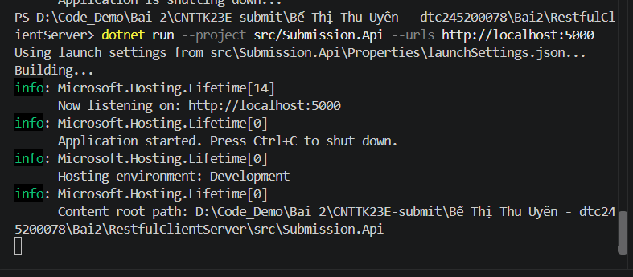
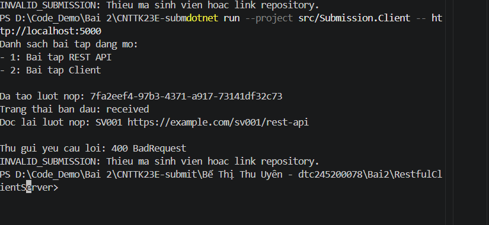

# Bài 2: RESTful API cho tương tác Client - Server (EduSubmit)

- **Sinh viên:** Bế Thị Thu Uyên
- **MSSV:** dtc245200078
- **Lớp:** CNTTK23E

## 1. Các lệnh đã chạy

```powershell
# Tạo solution và 2 project
dotnet new sln -n RestfulClientServer
dotnet new web -n Submission.Api -o src/Submission.Api
dotnet new console -n Submission.Client -o src/Submission.Client
dotnet sln add src/Submission.Api/Submission.Api.csproj
dotnet sln add src/Submission.Client/Submission.Client.csproj
dotnet new gitignore
dotnet build

# Chạy máy chủ (Terminal 1)
dotnet run --project src/Submission.Api --urls http://localhost:5000 ```


# Chạy máy khách (Terminal 2)
dotnet run --project src/Submission.Client -- http://localhost:5000
